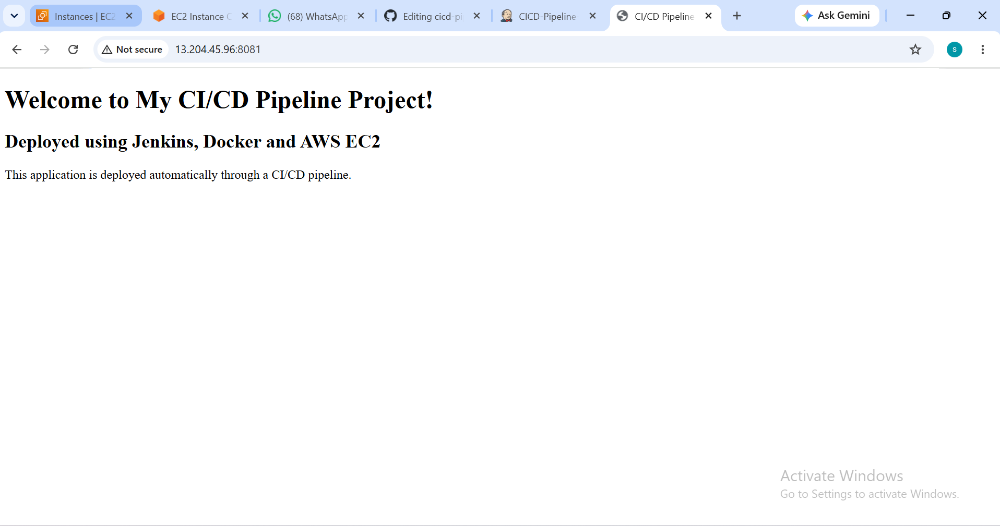
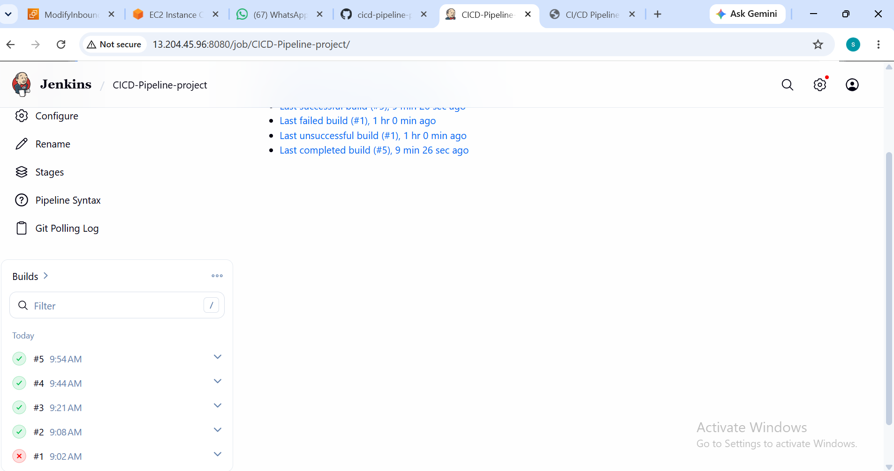
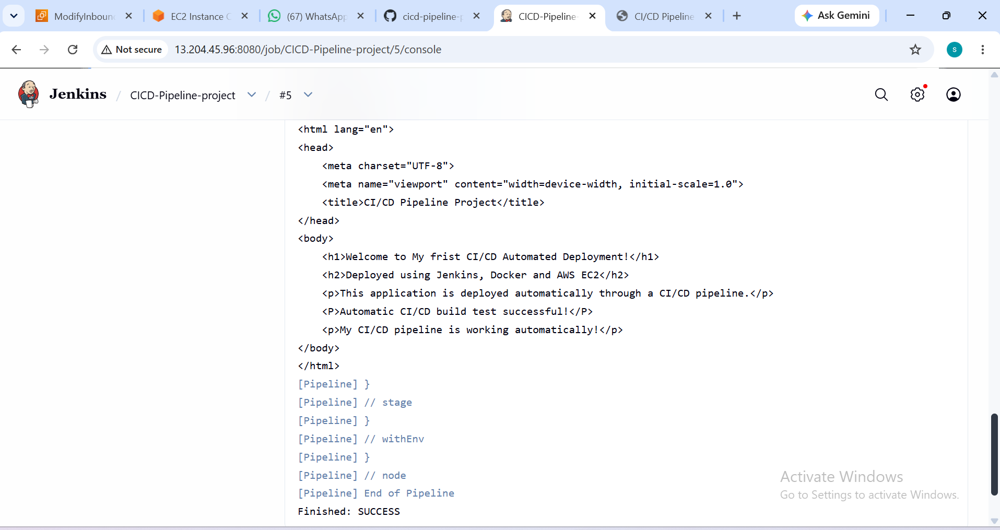
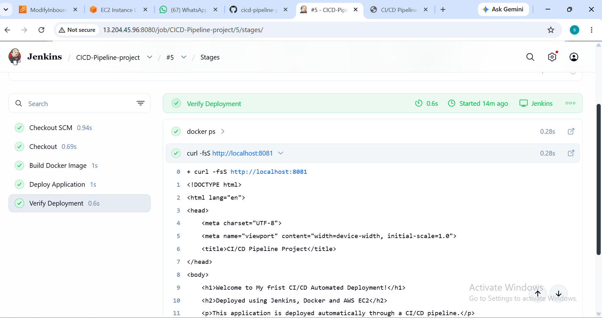
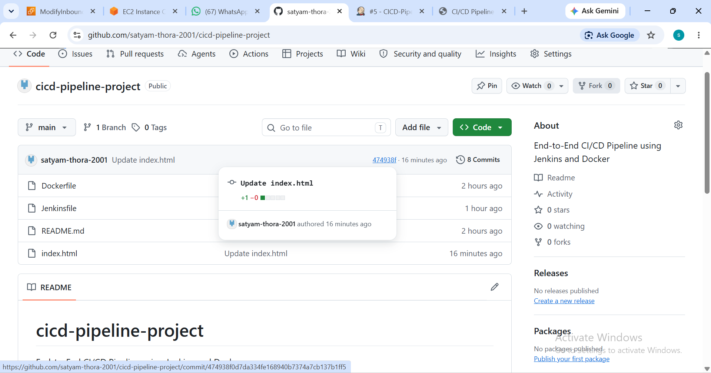
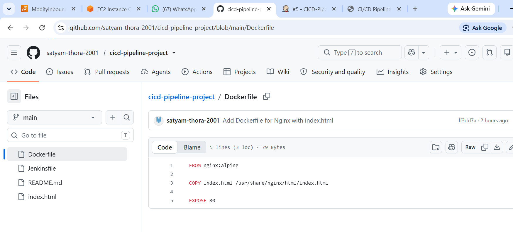
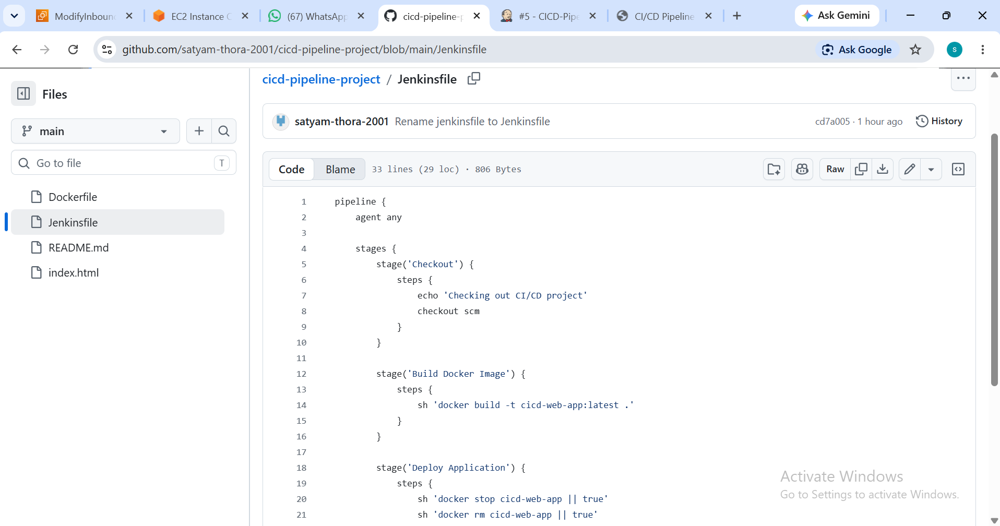
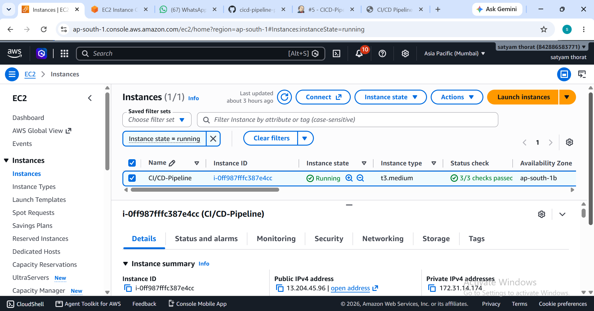

🚀 End-to-End CI/CD Pipeline Project

Automated Application Deployment using Jenkins, Docker, GitHub and AWS EC2

📌 Project Overview

This project demonstrates an End-to-End Continuous Integration and Continuous Deployment (CI/CD) pipeline using Jenkins, Docker, GitHub, and AWS EC2.

The application is automatically built, deployed, and hosted on an AWS EC2 Ubuntu server using Jenkins and Docker.

The main objective of this project is to automate the application deployment process and understand real-world DevOps practices.

🛠️ Technologies Used

- AWS EC2
- Ubuntu Linux
- Jenkins
- Docker
- Git
- GitHub
- Nginx
- HTML

🏗️ CI/CD Architecture

Developer
    |
    v
  GitHub
    |
    v
  Jenkins
    |
    v
Docker Image Build
    |
    v
Docker Container
    |
    v
  AWS EC2
    |
    v
Live Web Application

🔄 CI/CD Pipeline Workflow

1. Developer updates the application code.
2. Code is pushed to GitHub.
3. Jenkins checks out the latest source code.
4. Jenkins builds the Docker image.
5. Docker container is deployed.
6. Application is verified using curl.
7. The live application is accessible through a web browser.

⚙️ Jenkins Pipeline Stages

- Checkout SCM
- Checkout
- Build Docker Image
- Deploy Application
- Verify Deployment

📂 Project Files

cicd-pipeline-project/
│
├── Dockerfile
├── Jenkinsfile
├── index.html
├── README.md
│
└── screenshot/
    ├── 01-live-application.png
    ├── 02-first-cicd-deployment.png
    ├── 03-automated-deployment-success.png
    ├── 04-jenkins-dashboard.png
    ├── 05-jenkins-pipeline-console.png
    ├── 06-jenkins-pipeline-stages.png
    ├── 07-github-repository.png
    ├── 08-dockerfile-configuration.png
    ├── 09-jenkinsfile-configuration.png
    └── 10-aws-ec2-instance-running.png

## 📸 Project Screenshots

### 1. Live Application

### 2. First CI/CD Deployment

### 3. Automated Deployment Success

### 4. Jenkins Dashboard

### 5. Jenkins Pipeline Console

### 6. Jenkins Pipeline Stages

### 7. GitHub Repository

### 8. Dockerfile Configuration

### 9. Jenkinsfile Configuration

### 10. AWS EC2 Instance

✅ Project Results

- Successfully created an automated CI/CD pipeline.
- Integrated GitHub with Jenkins.
- Built a Docker image using a Dockerfile.
- Deployed the application using Docker.
- Hosted the web application on AWS EC2.
- Verified the application deployment through Jenkins.

🎯 Skills Learned

- Linux Server Management
- Git and GitHub
- Jenkins CI/CD Pipeline
- Docker Image Building
- Docker Container Management
- AWS EC2 Deployment
- Application Troubleshooting

👨‍💻 Author

Satyam Thorat

GitHub: https://github.com/satyam-thora-2001

🔗 GitHub Repository

https://github.com/satyam-thora-2001/cicd-pipeline-project

---

⭐ Thank you for visiting my project!